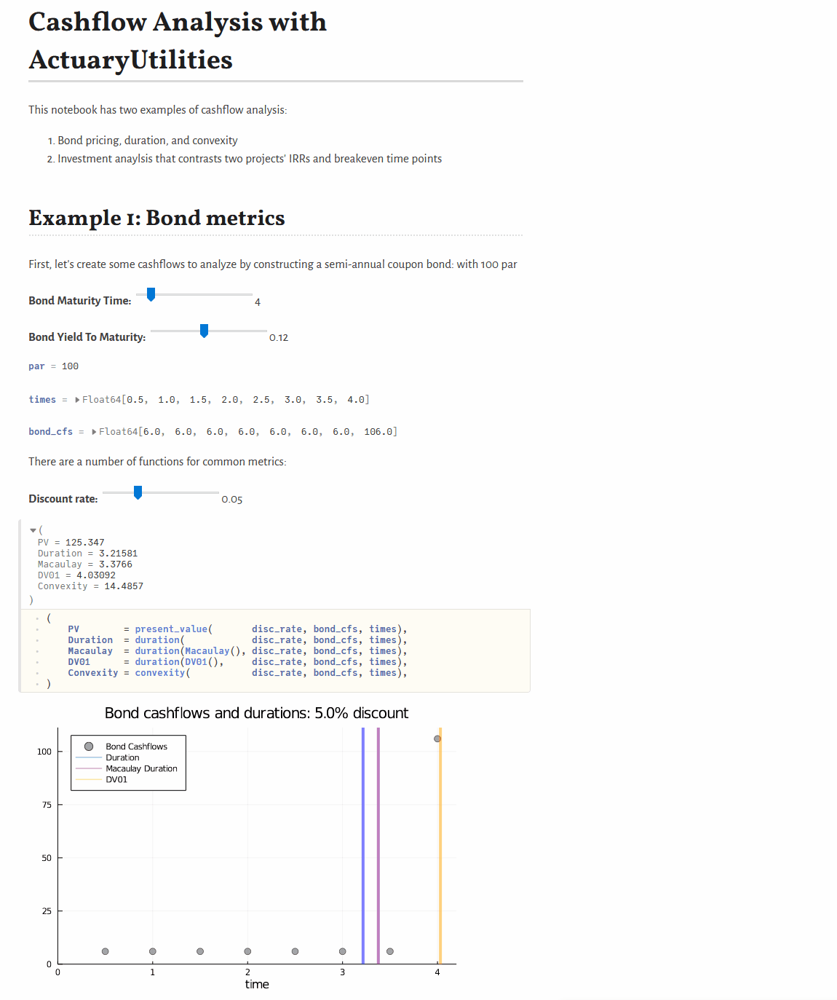

Scroll down below the sample video to see how to run it.

{fig-alt="Recording of a Pluto notebook adjusting cashflows and displaying valuation results."}


The recording above shows a [Pluto.jl](https://github.com/fonsp/Pluto.jl) notebook demonstrating some of the basic cashflow-oriented features in `ActuaryUtilities.jl` and `FinanceModels.jl`.

The linked Pluto notebook pins ActuaryUtilities 5.0 and FinanceModels 4.13 in its embedded environment. For ActuaryUtilities 6 and FinanceModels 7, see the [current cashflow and sensitivity examples](/packages.qmd#actuaryutilities.jl) and [upgrade guide](https://docs.juliaactuary.org/ActuaryUtilities/stable/upgrade/).

## Instructions to Run

Because JuliaActuary doesn't have an active server to run this on, you have to run it locally. Assuming that you already have Julia installed but still need to install Pluto notebooks:

1. Open a Julia REPL and copy and paste the following:

```julia
# install these dependencies
import Pkg; Pkg.add(["Pluto"]) 

# use and start Pluto
using Pluto; Pluto.run()
```


2. In the Pluto window that opens, enter this URL into the `Open from file:` box:

```
https://raw.githubusercontent.com/JuliaActuary/Learn/master/CashflowAnalysis.jl
```
