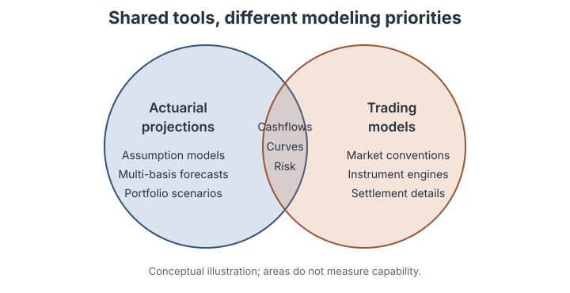

```{julia}
#| echo: false
#| output: false
using Pkg
Pkg.activate(".")
Pkg.instantiate()
using TOML
ql_reference = TOML.parsefile("quantlib-results.toml")
```

Actuarial projections and trading models share cashflows, curves and risk measures, but put different demands on them. A multi-basis forecast of 100,000 annuity contracts and 1,000 supporting assets needs consistent assumptions, robust aggregation and enough speed to explore scenarios. A trading model also needs detailed instrument and settlement conventions. Both require accuracy; their scope and computational trade-offs differ.

{fig-align="center" width="85%"}


This October 2026 update uses the registered releases FinanceCore 3.0.0, FinanceModels 7.0.1 and ActuaryUtilities 6.0.0, pinned in the [reproduction environment](#reproducing-the-comparison).

## Example: fixed bond analytics

Most bond analytics is a cashflow vector and a yield curve. Price, duration, convexity, key-rate durations, sensitivity to a calibrated curve, arbitrary-precision validation — all of those are things you *decide* to compute from those two inputs. The interesting design question is how much code each decision costs, and how much new machinery each new computation requires.

For the workflows it covers, [JuliaActuary](https://juliaactuary.org) offers a small vocabulary: `pv`, `duration`, `convexity`, `sensitivities` and curve constructors. FinanceCore supplies the cashflow and rate primitives, FinanceModels supplies curves, contracts and calibration, and ActuaryUtilities supplies the sensitivity interface and its analytic fixed-cashflow formulas. Custom valuation functions can be differentiated with `ForwardDiff`. The same cashflow vector carries through the bond examples.

[QuantLib](https://www.quantlib.org/) appears throughout as a reference. Its settlement conventions, holiday calendars and market-specific pricing engines support detailed instrument valuation. JuliaActuary emphasizes projections: cashflows and curves as composable values, generic numeric types, and calibration as ordinary optimization. The examples below show where these approaches meet, which quantities agree, and which comparisons require matching conventions first.

## The cashflow vector

A 5-year, 4% semi-annual-coupon bond priced against a simple upward-sloping zero curve (a flat 3% continuously-compounded yield appears later for the convention comparisons). Once the vector exists, price and duration are one function call each.

The Julia examples start with payment times expressed in years. The application is responsible for converting dated schedules, accrual periods and settlement rules into those inputs. QuantLib performs that work explicitly below using a schedule and a day-count convention. Here, unadjusted semiannual dates under 30/360 give the same half-year times as the Julia bond; this simple agreement does not cover irregular schedules or other market conventions.

```{julia}
using FinanceCore
using FinanceCore: Continuous, Periodic
using FinanceModels
using FinanceModels: Spline
using ActuaryUtilities
using Printf

coupon_rate = 0.04
maturity_years = 5
freq_per_year = 2
par = 100.0

# A simple upward-sloping zero curve. The t = 0 anchor lines up with QL's
# ZeroCurve boundary so both libraries are pricing against an identical grid.
tenors = [0.0, 1.0, 2.0, 3.0, 4.0, 5.0, 7.0]
base_zeros = [0.025, 0.025, 0.027, 0.029, 0.030, 0.032, 0.034]
curve = FinanceModels.ZeroRateCurve(base_zeros, tenors, Spline.Linear())

bond = FinanceModels.Bond.Fixed(coupon_rate, Periodic(freq_per_year), maturity_years)
cfs = collect(bond)

price = FinanceCore.pv(curve, cfs) * par
mod_dur = duration(Modified(), curve, cfs)

(price=price, modified=mod_dur)
```

QuantLib's setup uses a `Schedule`, a `FixedRateBond`, a `ZeroCurve` and a `DiscountingBondEngine`. It produces the same price:

```python
# Python — QuantLib via SWIG bindings
import QuantLib as ql

settle    = ql.Date(1, 1, 2026)
ql.Settings.instance().evaluationDate = settle
maturity  = ql.Date(1, 1, 2031)
day_count = ql.Thirty360(ql.Thirty360.BondBasis)

schedule = ql.Schedule(settle, maturity, ql.Period(ql.Semiannual),
                       ql.NullCalendar(), ql.Unadjusted, ql.Unadjusted,
                       ql.DateGeneration.Backward, False)
bond     = ql.FixedRateBond(0, 100.0, schedule, [0.04], day_count)

pillar_dates = [settle + ql.Period(y, ql.Years) for y in [0, 1, 2, 3, 4, 5, 7]]
zeros        = [0.025, 0.025, 0.027, 0.029, 0.030, 0.032, 0.034]
curve = ql.ZeroCurve(pillar_dates, zeros, day_count, ql.NullCalendar(),
                     ql.Linear(), ql.Continuous)
bond.setPricingEngine(ql.DiscountingBondEngine(ql.YieldTermStructureHandle(curve)))

print(bond.NPV())  # → 103.6781792217

ytm = bond.bondYield(day_count, ql.Continuous, ql.NoFrequency)   # ≈ 0.0317283
ir  = ql.InterestRate(ytm, day_count, ql.Continuous, ql.NoFrequency)
print(ql.BondFunctions.duration(bond, ir, ql.Duration.Modified))  # → 4.5902412191
```

| metric            | FinanceModels / ActuaryUtilities | QuantLib (Python) | diff    |
|-------------------|----------------------------------|-------------------|---------|
| Price             | 103.6781792217                   | 103.6781792217    | 0.00    |
| Modified duration | 4.5873235505                     | 4.5902412191      | 2.9e-03 |

The prices agree to the last printed digit. The durations answer different questions: `duration(Modified(), curve, cfs)` measures a parallel continuous-zero shift of the term-structured curve, while QL's `BondFunctions.duration` works from a single yield-to-maturity (about 3.17% continuously compounded here). The curve-based measure can also be calculated from curve-discounted cashflow moments or checked by bumping every pillar. The key-rate section below uses the latter check.

```{julia}
#| echo: false
#| output: false
@assert isapprox(price, ql_reference["values"]["term_price"]; atol=1e-9)
```

The interesting part is what the same `cfs` is about to do without writing any new code.

## Modified duration is the derivative

For a positive value, modified duration is `−d(log P)/dy`. Under a parallel continuous-zero shock, fixed cashflows give an analytic formula: `Σ t·cf·D(t) / P`. ActuaryUtilities uses that formula for the cashflow-vector call. For a valuation function, it differentiates through the valuation with ForwardDiff:

```{julia}
using ForwardDiff
mod_analytic = duration(Modified(), curve, cfs)
mod_ad = duration(c -> FinanceCore.pv(c, cfs), curve)
@assert isapprox(mod_analytic, mod_ad)
(analytic=mod_analytic, callback_ad=mod_ad)
```

The callback receives the shifted curve and can also reproject rate-dependent cashflows. Both routes avoid a finite-difference step size. AD differentiates the implemented computation, subject to floating-point accuracy and differentiability; it is not a guarantee of exact arithmetic.

The contrast with bump-and-reprice is visible if you ask the same question both ways:

```{julia}
# Parallel-shift the term-structured curve by `shift` at every pillar.
function mod_finite_diff(shift)
    yield_up = FinanceModels.ZeroRateCurve(base_zeros .+ shift, tenors, Spline.Linear())
    yield_dn = FinanceModels.ZeroRateCurve(base_zeros .- shift, tenors, Spline.Linear())
    p_up = FinanceCore.pv(yield_up, cfs)
    p_dn = FinanceCore.pv(yield_dn, cfs)
    p = FinanceCore.pv(curve, cfs)
    return (p_dn - p_up) / (2 * shift * p)
end

for h in (1e-2, 1e-4, 1e-6, 1e-8, 1e-10, 1e-12, 1e-14)
    fd = mod_finite_diff(h)
    err = abs(fd - mod_ad)
    @printf("shift = %.0e   mod (FD) = %.12f   |err vs AD| = %.2e\n", h, fd, err)
end
@printf("                   mod (AD) = %.12f\n", mod_ad)
```

Moderate shifts balance truncation error against cancellation. At very small shifts, subtracting nearly equal prices loses significant digits. The analytic and AD routes avoid that step-size trade-off; the printed errors show its effect for this particular bond.

For fixed cashflows, the analytic formula is simple and fast. AD becomes particularly useful when the valuation includes a differentiable projection or calibration pipeline, where deriving and maintaining every derivative by hand would take more work.

## Convexity is the next derivative

Convexity is `(d²P/dy²) / P`. QL's `BondFunctions.convexity` takes a *scalar* `InterestRate`, not a yield curve, so for this convention comparison both sides drop down to a flat 3% reference yield. Same bond, same cashflow vector — only the discounting model is flat instead of term-structured:

```{julia}
yield_flat = FinanceModels.Yield.Constant(Continuous(0.03))
convex = convexity(yield_flat, cfs)
```

QuantLib has a native `BondFunctions.convexity`:

```python
# Python — QuantLib
import math
y_ann = math.exp(0.03) - 1                  # annual-effective equiv. of 3% cont.
ir    = ql.InterestRate(y_ann, day_count, ql.Compounded, ql.Annual)
convex_quantlib = ql.BondFunctions.convexity(bond, ir)   # → 25.2585956899
```

The Python snippet above differentiates with respect to an annual-compounded rate. The Julia curve call differentiates with respect to a continuous-zero shift. To compare the same quantity, use continuous compounding in QuantLib:

```python
ir_cont = ql.InterestRate(0.03, day_count, ql.Continuous, ql.NoFrequency)
ql.BondFunctions.convexity(bond, ir_cont)  # → 22.2282840587
```

| metric                                                     |    value    |
|------------------------------------------------------------|------------:|
| `ActuaryUtilities.convexity(yield_flat, cfs)` (continuous-zero shock) | 22.2282840587 |
| QuantLib with a continuous `InterestRate`                    | 22.2282840587 |
| QuantLib with an annual-compounded `InterestRate`            | 25.2585956899 |

Writing `w_t = cf_t D(t)/P`, continuous-zero convexity is `Σ t² w_t`. Differentiating with respect to an annual-compounded rate `y` instead gives `Σ t(t+1) w_t / (1+y)²`. ActuaryUtilities returns the latter when passed an explicit `Periodic` rate rather than a curve. These are different derivatives of the same prices.

```{julia}
convex_periodic = convexity(Periodic(expm1(0.03), 1), cfs)
@assert isapprox(convex, ql_reference["values"]["flat_convexity"]; atol=1e-10)
@assert isapprox(convex_periodic, ql_reference["values"]["periodic_convexity"]; atol=1e-10)
(continuous=convex, annual_periodic=convex_periodic)
```

::: {.callout-note collapse="true"}
## Checking the analytic formula with AD

The fixed-cashflow implementation uses analytic moments. A nested derivative of the same price function provides an independent check of the continuous-zero convention:

```{julia}
using ForwardDiff

function price_at_continuous(y)
    yc = FinanceModels.Yield.Constant(Continuous(y))
    return FinanceCore.pv(yc, cfs)
end

ytm_flat = 0.03
P0 = price_at_continuous(ytm_flat)
convex_cont = ForwardDiff.derivative(
    y -> ForwardDiff.derivative(price_at_continuous, y), ytm_flat) / P0
```

This now agrees with the library's curve convexity:

```{julia}
@assert isapprox(convex_cont, convex)
(analytic=convex, nested_ad=convex_cont)
```

An explicit parameterization also lets you differentiate other smooth valuation functions. Higher derivatives can be expensive and numerically sensitive, so validate the order and parameter range you need.
:::

## Key-rate durations decompose the derivative

KRDs come from Thomas Ho's 1992 paper — *the* standard ALM sensitivity decomposition: shift the zero curve by a tent function centered at each key tenor, measure the price change, sum across pillars to recover the modified duration. ActuaryUtilities ships the tent bumper.

```{julia}
krd_pillars = collect(1.0:1.0:10.0)
krd = duration(KeyRates(krd_pillars), curve, cfs)

println("Pillar      KRD")
for (t, k) in zip(krd_pillars, krd)
    @printf("  %5.1fy   %12.8f\n", t, k)
end
@printf("\n  Σ KRD    = %12.8f\n", sum(krd))
@printf("  Modified = %12.8f\n", mod_dur)
```

A 5-year bond has no cashflows past year 5, so the long-end pillars are zero. The 5y pillar dominates because the principal repayment sits there. Fixed-cashflow key-rate durations are analytic in AU6; there is no internal finite-difference bump. Their sum agrees with parallel duration to floating-point precision.

QuantLib's [piecewise zero-spread curve](https://github.com/lballabio/QuantLib/blob/master/ql/termstructures/yield/piecewisezerospreadedtermstructure.hpp) uses linear interior spreads and flat endpoint spreads, matching this hat basis. We create the curve and pricing engine once, then bump its observable spread quotes. A central difference with a 0.1 bp step gives:

```{julia}
#| echo: false
#| output: asis
ql_krd = ql_reference["values"]["term_krd_reuse"]
@assert isapprox(sum(krd), mod_dur; atol=1e-12)
@assert maximum(abs.(krd .- ql_krd)) < 1e-8
println("| Pillar | AU analytic | QL central difference |\n|---:|---:|---:|")
for i in 1:5
    @printf("| %d y | %.8f | %.8f |\n", i, krd[i], ql_krd[i])
end
@printf("| 6–10 y | 0 | 0 |\n| **Sum** | **%.10f** | **%.10f** |\n", sum(krd), sum(ql_krd))
```

The hats sum to one at every tenor, so their key-rate durations aggregate to parallel duration. QuantLib's spread curve supplies the same flat endpoint behavior. The reference script also checks a version that rebuilds `ZeroCurve` objects; there the time-zero anchor moves with the first pillar to preserve this boundary convention. The small remaining difference from the analytic result is finite-difference error.

These are zero-rate shocks. For sensitivities to par quotes, pass market inputs to a valuation callback that rebuilds or refits the curve; the removed `KeyRatePar` marker is not part of AU6.

## The whole sensitivity bundle in one call

ActuaryUtilities' `sensitivities` returns value, duration and DV01. Add `SecondOrder()` for convexity and dollar convexity; the default `FirstOrder()` avoids calculating second derivatives. The `KeyRates(tenors)` marker carries the reporting grid, independently of the curve's storage tenors:

```{julia}
zero_rates = [0.02, 0.025, 0.028, 0.030, 0.032, 0.034]
tenors = [1.0, 2.0, 3.0, 5.0, 7.0, 10.0]
zrc = FinanceModels.ZeroRateCurve(zero_rates, tenors)

result = sensitivities(SecondOrder(), KeyRates(tenors), zrc, cfs)

@printf("price                  = %.6f\n", result.value * par)
println("durations by pillar    = ", round.(result.duration; digits=6))
@printf("Σ durations            = %.6f   (≈ total Modified duration)\n",
    sum(result.duration))
@printf("Σ convexities (matrix) = %.6f   (continuous-shock convexity)\n",
    sum(result.convexity))
```

Each entry of `result.duration` is a normalized sensitivity to one hat-shaped zero-rate shock. Fixed-cashflow formulas accumulate these contributions directly. The 6×6 `result.convexity` matrix contains `∂²V / ∂z_i ∂z_j / V`; `result.dollar_convexity` contains the unnormalized Hessian. Summing all entries, including cross terms, gives parallel continuous-zero convexity for this same curve. Its value differs from the earlier flat-curve example because the discount curves differ.

The same result already contains the per-pillar *dollar value of a basis point*, using the convention that a positive DV01 denotes a loss for an upward 1 bp shock. Scale the unit-par cashflows to the position's par amount:

```{julia}
dv01s = result.dv01
(per_pillar = round.(dv01s .* par; digits=6), total = sum(dv01s) * par)
```

For a contract, use `sensitivities(KeyRates(tenors), zrc, bond)`, with `SecondOrder()` before `KeyRates` if needed. Contract valuations differentiate through the projection and report discount and index roles in fields such as `.duration.discount` and `.duration.index`; sum the roles for effective duration. Two-curve valuation callbacks also support `IR01()` and `CS01()`. For fixed payments discounted by a base-plus-credit curve, those parallel exposures coincide; distinct roles become useful when payments themselves depend on a curve.

Generic numeric code also makes higher-precision validation possible. This example runs in `BigFloat`; the callback examples use `ForwardDiff.Dual`:

```{julia}
yield_big = FinanceModels.Yield.Constant(Continuous(big"0.03"))
cfs_big = collect(FinanceModels.Bond.Fixed(big"0.04", Periodic(2), 5))
duration(Modified(), yield_big, cfs_big)
```

With QuantLib the entire library is compiled against a single `Real` typedef (`double` in every stock distribution); changing precision means recompiling the C++ library and its bindings, not swapping a type at the call site.

Generic numeric types still require a differentiable computation and adequate floating-point accuracy. The examples here exercise specific models and parameter ranges; they do not establish that every composed valuation has a reliable gradient.

::: {.callout-warning collapse="true"}
## Numerical limits of automatic differentiation

Code and storage must accept dual numbers; a Float64-only buffer or an unsupported foreign-library call can break the chain. Mutation itself is not the problem. Payoff kinks, interpolation branches and solver convergence also need attention. See [ForwardDiff's limitations](https://juliadiff.org/ForwardDiff.jl/stable/user/limitations/).

FinanceModels has numerical limits too. In discount-factor blends, extremely small weights or widely separated component log-discounts can produce inaccurate derivatives, including spurious zeros, `Inf` or `NaN`, even when the price and mathematical derivative are finite. This can affect weights, time and curve parameters, and can differ between direct discounts, zero rates, intervals and composed curves. Check sensitivities in these regimes against analytic or suitably higher-precision references; a finite price alone does not establish a reliable gradient.
:::

::: {.callout-note collapse="true"}
## Under the hood: writing your own AD pipeline

If `sensitivities` doesn't bundle exactly what you want — different curve type, different valuation function, mixed asset/liability portfolio — write the AD call directly:

```{julia}
function price_from_zeros(rates)
    curve = FinanceModels.ZeroRateCurve(rates, tenors)
    return FinanceCore.pv(curve, cfs) * par
end

ForwardDiff.gradient(price_from_zeros, zero_rates)
```

This gradient differentiates the curve constructor and its interpolation with respect to the stored rates. `KeyRates`, in contrast, specifies an additive hat-shaped shock to the resulting curve. Those are different risk definitions unless the construction and shock bases coincide. The direct callback is useful when the parameters being calibrated or hedged are the actual curve inputs. `ForwardDiff.hessian(price_from_zeros, zero_rates)` gives their second derivatives, subject to the same numerical and differentiability limits.
:::

## Sensitivities to the quotes used to calibrate a curve

A zero-rate shock and a change to a calibration quote define different risks. Here the inputs are annualized semiannual par yields. Each valuation bootstraps a new curve from those quotes and then prices the original fixed-cashflow bond:

```{julia}
par_tenors = [1.0, 2.0, 3.0, 5.0, 10.0]
par_yields = [0.02, 0.024, 0.028, 0.032, 0.035]

function curve_from_par(yields)
    quotes = FinanceModels.ParYield.(yields, par_tenors; frequency=Periodic(2))
    return FinanceModels.fit(Spline.Linear(), quotes, Fit.Bootstrap())
end
calibrated_bond_value(yields) = FinanceCore.pv(curve_from_par(yields), cfs) * par

quote_risk = sensitivities((; par_yields)) do market
    calibrated_bond_value(market.par_yields)
end

(price=quote_risk.value, par_quote_dv01=quote_risk.dv01.par_yields)
```

Each bucket is `−∂V/∂quote × 10⁻⁴`: the first-order value loss for a 1 bp increase in that par quote, holding the other quotes fixed and recalibrating. The buckets sum to sensitivity to a parallel shift of the par quotes. That sum need not equal the parallel continuous-zero sensitivity of the fitted curve.

We can check the fitted instruments and the five-year quote derivative independently:

```{julia}
calibrated_curve = curve_from_par(par_yields)
calibration_quotes = FinanceModels.ParYield.(par_yields, par_tenors; frequency=Periodic(2))
@assert all(isapprox(FinanceCore.pv(calibrated_curve, q.instrument), q.price; atol=1e-10)
    for q in calibration_quotes)

i = findfirst(==(5.0), par_tenors)
h = 1e-5                              # 0.1 bp in decimal yield units
up, down = copy(par_yields), copy(par_yields)
up[i] += h
down[i] -= h
dv01_refit_fd = (calibrated_bond_value(down) - calibrated_bond_value(up)) / (2h) * 1e-4
@assert isapprox(quote_risk.dv01.par_yields[i], dv01_refit_fd; rtol=1e-6, atol=1e-9)
(ad_dv01=quote_risk.dv01.par_yields[i], refit_fd_dv01=dv01_refit_fd)
```

This demonstrates differentiation through this bootstrap and its linear zero-rate interpolation. Other calibration procedures need their own checks for convergence, differentiability and numerical accuracy.

## When the cashflows respond to rates

Everything so far assumed the cashflow vector was *fixed*. That works for the bond above. Many ALM exposures require payments that respond to rates: callable bonds, prepayable mortgages, life-insurance liabilities with dynamic lapse behavior, and GICs with surrender options. The policyholder or borrower has an option whose exercise correlates with rates, so projecting the cashflows becomes part of the sensitivity calculation.

The simplest non-trivial case is a level-pay mortgage pool with a constant conditional prepayment rate (CPR). The pass-through cashflow generator is the standard factor model: the underlying mortgage amortizes on its original schedule, and each period a fraction `cpr` of the surviving balance prepays voluntarily on top of the scheduled cashflow.

```{julia}
using FinanceCore: Cashflow

function passthrough_cfs(wac, balance, term, cpr)
    payment = balance * wac / (1 - (1 + wac)^(-term))
    sched_bal = balance
    factor = one(cpr)
    map(1:term) do t
        sched_int = sched_bal * wac
        sched_prin = payment - sched_int
        sched_bal_end = sched_bal - sched_prin
        cf = factor * payment + factor * cpr * sched_bal_end
        factor *= one(cpr) - cpr
        sched_bal = sched_bal_end
        Cashflow(cf, Float64(t))
    end
end

wac_m, term_m, bal_m = 0.05, 10, 100.0
y_market = 0.04
yj_market = FinanceModels.Yield.Constant(Continuous(y_market))

cfs_static = passthrough_cfs(wac_m, bal_m, term_m, 0.06)
(price=FinanceCore.pv(yj_market, cfs_static),
    mod_dur=duration(Modified(), yj_market, cfs_static),
    convexity=convexity(yj_market, cfs_static))
```

Fifteen lines of ordinary code; the output is an ordinary `Vector{Cashflow}`. Every primitive from the previous sections — `pv`, `duration`, `convexity`, `sensitivities` — works on it without modification. The mortgage is at a premium (gross coupon 5%, market yield 4%), so as the prepayment assumption rises the price drops toward par — the textbook MBS sensitivity, and a useful sanity check:

```{julia}
[(cpr=c, price=FinanceCore.pv(yj_market, passthrough_cfs(wac_m, bal_m, term_m, c)))
 for c in (0.0, 0.06, 0.20, 0.99)]
```

The *interesting* thing about a prepayment-sensitive asset is that CPR isn't a constant. When rates fall, refinancing accelerates and CPR rises. Write a refi-incentive model as ordinary Julia, slot it into the price function, and `ForwardDiff` walks the analytic derivative through *both* the discounting *and* the prepayment response:

```{julia}
refi_cpr(y; base=0.06, sens=2.0, wac_ref=0.05) =
    base + sens * max(zero(y), wac_ref - y)

function price_with_refi(y)
    cfs = passthrough_cfs(wac_m, bal_m, term_m, refi_cpr(y))
    return FinanceCore.pv(FinanceModels.Yield.Constant(Continuous(y)), cfs)
end

P0_oa = price_with_refi(y_market)
model_dur = -ForwardDiff.derivative(price_with_refi, y_market) / P0_oa
model_conv = ForwardDiff.derivative(
    z -> ForwardDiff.derivative(price_with_refi, z), y_market) / P0_oa

cpr_at_market = refi_cpr(y_market)       # 8%, including the refi incentive
frozen_cfs = passthrough_cfs(wac_m, bal_m, term_m, cpr_at_market)
@assert isapprox(P0_oa, FinanceCore.pv(yj_market, frozen_cfs))
frozen_dur = duration(Modified(), yj_market, frozen_cfs)
frozen_conv = convexity(yj_market, frozen_cfs)

(price=P0_oa, cpr=cpr_at_market,
    frozen_duration=frozen_dur, model_duration=model_dur,
    frozen_convexity=frozen_conv, model_convexity=model_conv)
```

At the current market rate, the refi rule gives an 8% CPR. Freezing that same CPR gives duration **4.1606**; allowing CPR to respond to rates reduces it to **3.9712**. Both valuations start from the same price and cashflows, so this difference isolates the refinancing response. Convexity changes from **24.3737** to **−19.1634**, as faster prepayment when rates fall limits price appreciation. The earlier 6% CPR example has a different starting cashflow vector and is not the baseline for this comparison.

These are local derivatives of the specified prepayment model, away from its kink at `y = wac_ref`. The example is a deterministic sensitivity demonstration. It does not implement a calibrated stochastic mortgage or option-adjusted spread engine, and its linear CPR response would need bounds and calibration for production use.

The same pattern applies to a differentiable dynamic-lapse or default model. At a kink, an ordinary derivative may not exist: choose an appropriate directional or finite-change risk measure, or justify a smooth approximation. A smaller finite-difference step cannot create a derivative that the model does not have.

The QL equivalent for the static case is `AmortizingFixedRateBond` with a custom cashflow `Leg`. The cashflow-generator logic looks similar; what differs is that sensitivities to the prepayment model require bump-and-recompute by hand, which AD does implicitly here.

## Stochastic short-rate models

FinanceModels implements `ShortRate.Vasicek`, `ShortRate.CoxIngersollRoss` and `ShortRate.HullWhite`, with closed-form zero-coupon prices. `simulate` uses exact Gaussian rate transitions for Vasicek and Hull–White and full truncation for CIR. Each scenario is a `RatePath <: AbstractYieldModel`, so the existing valuation functions can price cashflows against it. Pathwise discount integrals use trapezoidal integration:

```{julia}
using FinanceModels: ShortRate, simulate
using Random, Statistics

hw = ShortRate.HullWhite(0.05, 0.01, yj_market)   # mean-rev a, vol σ, calibrating curve
rng = Random.MersenneTwister(42)
paths = simulate(hw; n_scenarios=10_000, timestep=1 / 12, horizon=10.0, rng)
hw_pvs = [FinanceCore.present_value(p, cfs_static) for p in paths]

(deterministic=FinanceCore.pv(yj_market, cfs_static),
    hull_white_mc=mean(hw_pvs),
    mc_standard_error=std(hw_pvs) / sqrt(length(hw_pvs)))
```

In the continuous Hull–White model calibrated to the curve, expected discount factors reproduce that curve, so the expected PV of fixed cashflows is the deterministic PV. The simulation approximates the discount integral: exact rate transitions do not make the discounted estimator unbiased. More paths reduce sampling error; finer timesteps address integration error. These examples keep the supplied payment amounts and times fixed across scenarios. They demonstrate stochastic discounting and its sensitivities; a stochastic prepayment or OAS model would also need payments that respond to each simulated path.

AU6 makes the Monte Carlo choice explicit with `Scenarios`. Passing the bare short-rate model instead uses its deterministic discount function. Scenario sensitivities differentiate the sampled valuation with common random numbers. As elsewhere, add `SecondOrder()` only when a Hessian is needed:

```{julia}
mc_tenors = [1.0, 2.0, 3.0, 5.0, 7.0, 10.0]
scenarios = Scenarios(hw;
    n_scenarios=5_000, timestep=1 / 12, horizon=10.0, rng=Random.MersenneTwister(42))

mc_sens = sensitivities(KeyRates(mc_tenors), scenarios, cfs_static)

(value=mc_sens.value, total_duration=sum(mc_sens.duration))
```

The key-rate contributions aggregate to the parallel sensitivity of the sampled valuation. Sampling uncertainty and discretization error still matter. The bundle does not itself report standard errors; estimate those with independent runs or retained per-path contributions when reporting stochastic sensitivities.

Under the hood that's an ordinary `ForwardDiff` pass, and you can write it by hand for any parameter the bundled call doesn't cover. Differentiating the Monte-Carlo PV against Vasicek's initial short rate, for instance, returns a stochastic-model duration:

```{julia}
function pv_mc_vasicek_r0(r0)
    rng = Random.MersenneTwister(42)
    v = ShortRate.Vasicek(0.10, 0.04, 0.01, Continuous(r0))
    ps = simulate(v; n_scenarios=5_000, timestep=1 / 12, horizon=10.0, rng)
    return sum(FinanceCore.present_value(p, cfs_static) for p in ps) / 5_000
end

r0_base = 0.04
P_vas = pv_mc_vasicek_r0(r0_base)
dPdr0_vas = ForwardDiff.derivative(pv_mc_vasicek_r0, r0_base)

(pv=P_vas,
    dpv_dr0=dPdr0_vas,
    stochastic_model_duration=-dPdr0_vas / P_vas)
```

Resetting the seed keeps the sampled random draws fixed while differentiating the simulation. Initial rates, mean reversion `a` and volatility `σ` can all carry dual numbers through the Vasicek and Hull–White paths; the earlier Float64-buffer limitation is fixed. The derivative is of the implemented sampled approximation. Convergence to the continuous model's expected sensitivity is a separate check.

Stock QuantLib-Python uses ordinary floating-point numbers in its C++ engines rather than carrying an AD type through the valuation. Differentiation inside the engine is another approach: [QuantLib-Risks](https://github.com/auto-differentiation/QuantLib-Risks-Py) provides an XAD-based distribution. Here the Julia advantage is the ability to differentiate the same simulation and valuation code used for the ordinary calculation, within its supported numerical domain.

What FM lacks is the *lattice* layer: there's no trinomial-tree engine for early-exercise payoffs, no built-in Longstaff-Schwartz for American Monte Carlo, no multi-factor models like G2++ or LMM, and no calibrator against a swaption-cube vol surface. For a Bermudan callable bond valued under a calibrated short-rate model with market vols, QL's tree engine is still the right tool. The QL-only territory is more precisely *lattice-based early-exercise valuation under stochastic rates*, rather than stochastic rates in general, which JA handles directly.

## Performance

These benchmarks compare Julia calls with QuantLib's Python interface. Price, duration and convexity use the same 5-year semiannual bond and a flat 3% continuously compounded yield. The key-rate comparison uses 30 annual continuous-zero shock pillars for two bonds: the original 5-year bond and a 30-year bond with payments across the whole reporting grid.

For each key-rate case, we measure two QuantLib implementations: rebuilding curves and engines for each bump, and reusing a native `PiecewiseZeroSpreadedTermStructure` and its engine while changing `SimpleQuote` spreads. The reused-curve implementation is the primary comparison. Both use the same central-difference step and flat endpoint hats as the earlier correctness check.

```{julia}
using BenchmarkTools

b_price = @benchmark FinanceCore.pv($yield_flat, $cfs) seconds=2
b_mod = @benchmark duration(Modified(), $yield_flat, $cfs) seconds=2
b_conv = @benchmark convexity($yield_flat, $cfs) seconds=2

krd_pillars_30 = collect(1.0:1.0:30.0)
zrc_30 = FinanceModels.ZeroRateCurve(fill(0.03, 30), krd_pillars_30)
key_rates_30 = KeyRates(krd_pillars_30)
cfs_30y = collect(FinanceModels.Bond.Fixed(coupon_rate, Periodic(freq_per_year), 30))
b_krd_5y = @benchmark duration($key_rates_30, $zrc_30, $cfs) seconds=2
b_krd_30y = @benchmark duration($key_rates_30, $zrc_30, $cfs_30y) seconds=2

julia_ns = Dict(
    "price" => minimum(b_price).time,
    "duration" => minimum(b_mod).time,
    "convexity" => minimum(b_conv).time,
    "krd_5y" => minimum(b_krd_5y).time,
    "krd_30y" => minimum(b_krd_30y).time,
)
```

```{julia}
#| echo: false
#| output: false
krd_case_errors = Dict{String, Float64}()
for (suffix, payments) in (("5y", cfs), ("30y", cfs_30y))
    analytic = duration(key_rates_30, zrc_30, payments)
    @assert isapprox(FinanceCore.pv(zrc_30, payments) * par,
        ql_reference["values"]["flat_price_" * suffix]; atol=1e-9)
    @assert isapprox(sum(analytic), ql_reference["values"]["flat_duration_" * suffix]; atol=1e-10)
    for method in ("reuse", "rebuild")
        reference = ql_reference["values"]["krd_" * suffix * "_" * method]
        @assert isapprox(analytic, reference; rtol=2e-8, atol=1e-8)
    end
    krd_case_errors[suffix] = maximum(abs.(analytic .- ql_reference["values"]["krd_" * suffix * "_reuse"]))
end
@assert all(>(0), duration(key_rates_30, zrc_30, cfs_30y))
```

```{julia}
#| echo: false
#| output: asis
ql_ns = ql_reference["nanoseconds"]
println("| 5-year bond workload | Julia (ns/call) | QuantLib-Python (ns/call) | QL / Julia |")
println("|---|---:|---:|---:|")
for (label, j, q) in (
    ("Price / cached QL NPV", "price", "price_cached"),
    ("Price / forced QL reprice", "price", "price_recomputed"),
    ("Modified duration", "duration", "duration"),
    ("Continuous-zero convexity", "convexity", "convexity"),
)
    @printf("| %s | %.1f | %.1f | %.1f× |\n", label, julia_ns[j], ql_ns[q], ql_ns[q] / julia_ns[j])
end
println("\nAll 30 key-rate buckets, in **microseconds per vector**:\n")
println("| Bond maturity | Julia analytic | QL reused curve | QL rebuilt curves | Reused QL / Julia |")
println("|---|---:|---:|---:|---:|")
for suffix in ("5y", "30y")
    j, reuse, rebuild = julia_ns["krd_" * suffix], ql_ns["krd_" * suffix * "_reuse"], ql_ns["krd_" * suffix * "_rebuild"]
    @printf("| %s | %.3f | %.3f | %.3f | %.1f× |\n", suffix, j / 1000, reuse / 1000, rebuild / 1000, reuse / j)
end
@printf("\nMaximum absolute differences between analytic and reused-curve KRDs: %.2e (5y) and %.2e (30y).\n", krd_case_errors["5y"], krd_case_errors["30y"])
```

Julia timings are minima from warmed BenchmarkTools trials with interpolated inputs. Python timings are minima of seven `timeit` repeats, with an automatically selected loop count taking at least 0.2 seconds per repeat. Both include allocation of the returned key-rate vector. Reusable schedules, dates, quote handles, base prices and initial pricing engines are prepared before timing. The versions, hardware and raw results are recorded below.

The cached QuantLib row returns an already calculated price. The forced-reprice row calls `bond.recalculate()` before `bond.NPV()`. Duration and convexity are computed on each call. Julia's fixed-cashflow sensitivities use analytic cashflow moments, with each key-rate contribution touching only the neighboring hats. The 30-year case exercises all 30 buckets; the 5-year case has zero exposure beyond maturity.

The reused QuantLib curve avoids repeated engine and curve construction, but it still reprices for each side of each pillar bump. The remaining key-rate gap includes an algorithmic difference between analytic accumulation and bump-and-reprice. These are measurements of these implementations; an analytic calculation over QuantLib cashflows would be another comparison. They do not isolate language or binding overhead or establish portfolio throughput.

::: {.callout-note collapse="true"}
## Checking the analytic key rates with an AD callback

The fixed-cashflow route and the callback route use the same hats. This checks that their definitions agree, independently of their calculation methods:

```{julia}
krds_analytic = duration(key_rates_30, zrc_30, cfs)
krds_ad = duration(c -> FinanceCore.pv(c, cfs), key_rates_30, zrc_30)
@assert isapprox(krds_analytic, krds_ad; atol=1e-12)
maximum(abs.(krds_analytic .- krds_ad))
```

The callback can also generate rate-dependent cashflows. The analytic fixed-cashflow route intentionally holds payment amounts and times fixed.
:::

## Reproducing the comparison

The [Julia environment](Project.toml) pins FinanceCore 3.0.0, FinanceModels 7.0.1 and ActuaryUtilities 6.0.0 from the Julia registry. It requires Julia 1.13 or later within the 1.x series. The [QuantLib reference script](quantlib_reference.py) is runnable independently with the [pinned Python dependency](requirements.txt). It regenerates the [reference values and timings](quantlib-results.toml), including the date, Python version, QuantLib version and machine model.

From this post's directory:

```sh
python3 -m venv .venv
.venv/bin/python -m pip install -r requirements.txt
.venv/bin/python quantlib_reference.py
julia --project=. reproduce.jl
```

[reproduce.jl](reproduce.jl) executes the Julia chunks, including the comparisons with the saved Python results, and writes [julia-results.toml](julia-results.toml), which records all resolved Julia package versions. Use `quarto render posts/quantlib-comparison/index.qmd` from the website root to rebuild the page. Python snippets in this post are explanatory; Quarto executes the Julia chunks and reads the separately generated Python reference file. Rerun both sides on the same machine before comparing timings; a Julia-only render still reads the saved Python measurements.

```{julia}
#| echo: false
#| output: asis
benchmark_metadata = Dict(
    "julia" => string(VERSION),
    "cpu" => Sys.cpu_info()[1].model,
    "kernel" => string(Sys.KERNEL),
    "architecture" => string(Sys.ARCH),
    "threads" => Threads.nthreads(),
)
package_versions = Dict(info.name => string(info.version) for info in values(Pkg.dependencies()) if info.version !== nothing)
open("julia-results.toml", "w") do io
    TOML.print(io, Dict(
        "metadata" => benchmark_metadata,
        "packages" => package_versions,
        "nanoseconds" => julia_ns,
        "values" => Dict("term_price" => price, "term_duration" => mod_dur,
            "flat_convexity" => convex, "term_krd" => krd,
            "par_quote_price" => quote_risk.value,
            "par_quote_dv01" => quote_risk.dv01.par_yields,
            "par_quote_fd_dv01_5y" => dv01_refit_fd,
            "refi_cpr" => cpr_at_market,
            "frozen_duration" => frozen_dur, "refi_duration" => model_dur,
            "frozen_convexity" => frozen_conv, "refi_convexity" => model_conv,
            "krd_30y" => duration(key_rates_30, zrc_30, cfs_30y)),
    ); sorted=true)
end
qm = ql_reference["metadata"]
println("Reference machine: **$(qm["hardware"])**, $(qm["os"]). Python **$(qm["python"])**, QuantLib **$(qm["quantlib"])**; Python measurements dated $(qm["date"]).\n")
println("This render: Julia **$(VERSION)**, FinanceCore **$(package_versions["FinanceCore"])**, FinanceModels **$(package_versions["FinanceModels"])**, ActuaryUtilities **$(package_versions["ActuaryUtilities"])**, BenchmarkTools **$(package_versions["BenchmarkTools"])**, ForwardDiff **$(package_versions["ForwardDiff"])**. Julia CPU: $(benchmark_metadata["cpu"]); $(Threads.nthreads()) Julia threads. The benchmarked analytics are serial.\n")
```

## When you'd reach for QuantLib instead

FinanceModels now covers Gaussian short-rate models, differentiable simulation, FX forwards, deterministic constant-notional basis-swap calibration, and par/OIS curve bootstrapping with explicit year fractions. QuantLib remains broader in market-specific schedules, holiday calendars, day counts, settlement and fixing conventions, and instrument-specific engines. Its trading-model coverage also includes early-exercise lattices, multi-factor models, volatility models and surface calibration, and credit, inflation and commodity term structures. Support for an FX forward or a par-swap quote does not imply full coverage of every market convention or stochastic cross-currency adjustment.

JuliaActuary emphasizes projecting cashflows, fitting curves, calculating sensitivities and running scenarios with reusable numerical code. For the examples here, analytic formulas handle fixed-payment risk efficiently, while AD extends the same valuation functions to custom projections. QuantLib's larger instrument and convention library can save substantial implementation work when those details are central to the valuation.

The choice depends on the calculation: the supplied instrument conventions, the projection logic, the risk definition and the workload all matter.

---

The bond's `cfs` vector supported price, duration, convexity, key-rate risk and sensitivities to bootstrapped par quotes. Its mortgage-pool counterpart supported a deterministic prepayment response and fixed-payment valuation under Hull–White discounting scenarios. These examples share cashflow and curve interfaces while using different numerical methods where appropriate: analytic moments for fixed payments, AD for differentiable valuation functions, and simulation for stochastic discounting.

**One vector of cashflows. One curve. The rest is just ordinary Julia.**

---

*Drafted with AI assistance under my direction. Julia chunks execute at render time; QuantLib reference values and timings are generated separately by the linked Python script. The comparison assertions are rerun when the page is rendered.*
