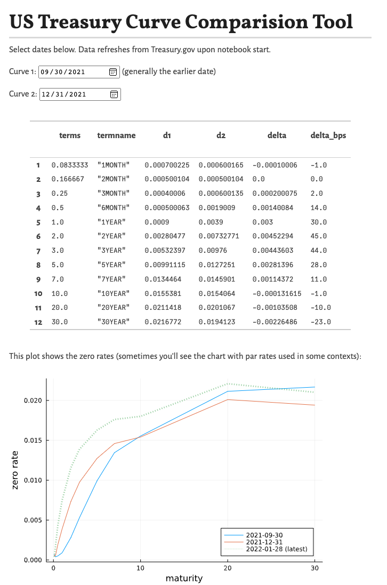

{fig-alt="Pluto notebook comparing US Treasury zero-rate curves for two selected dates."}

The screenshot above shows a [Pluto.jl](https://github.com/fonsp/Pluto.jl) notebook where you can select a pair of dates and find the change in the treasury curve's zero rates.

The linked notebook pins FinanceModels 4.4. The [yield-curve fitting tutorial](/posts/fitting-yield-curves/index.qmd) uses FinanceModels 7, including linear-only bootstrapping and the current extrapolation defaults.

## Instructions to Run

Because JuliaActuary doesn't have an active server to run this on, you have to run it locally. Assuming that you already have Julia installed but still need to install Pluto notebooks:

1.  Open a Julia REPL and copy and paste the following:

``` julia

# install these dependencies
import Pkg; Pkg.add(["Pluto"]) 

# use and start Pluto
using Pluto; Pluto.run()
```

2.  In the Pluto window that opens, enter this URL into the `Open from file:` box:

```         
https://raw.githubusercontent.com/JuliaActuary/Learn/master/USTreasuryComparison.jl
```